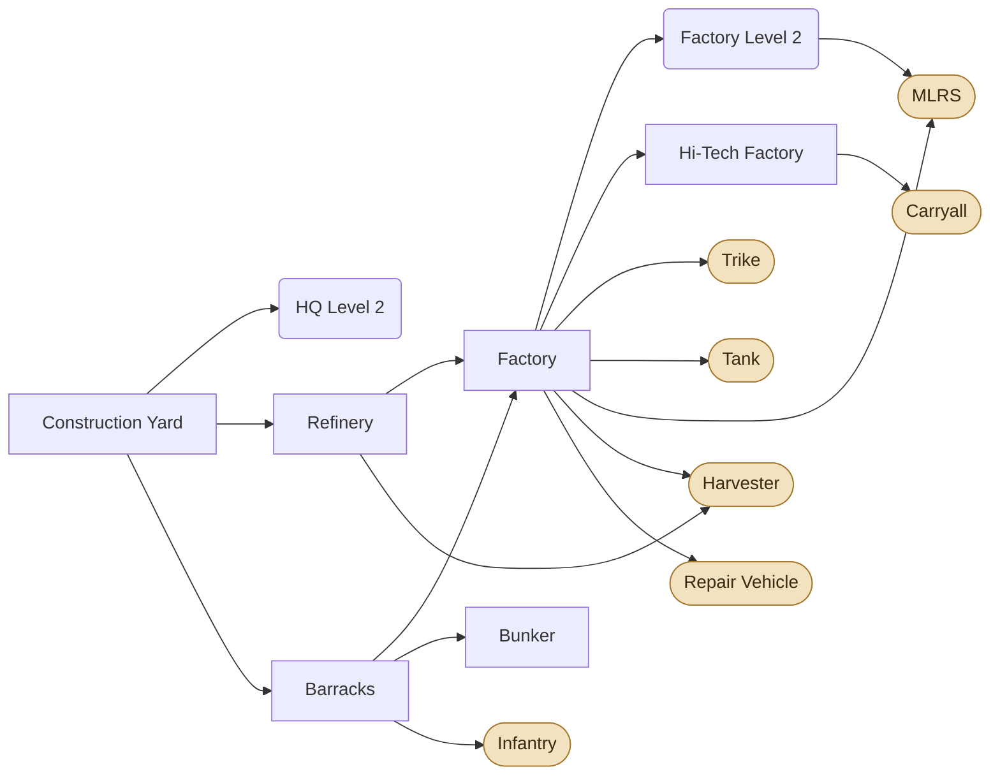
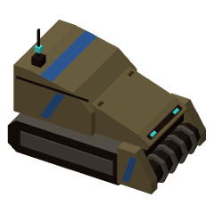
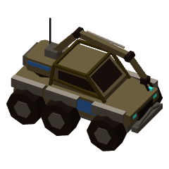
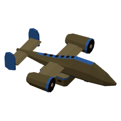
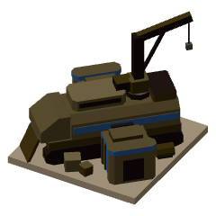
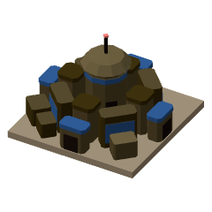
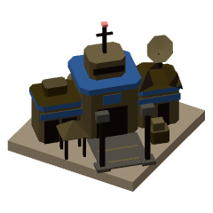
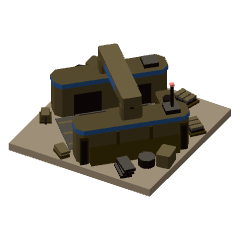
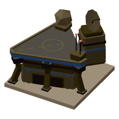
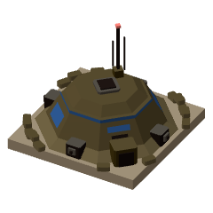

# Atreides

[Manual](README.md) · **Atreides** · [Corrino](corrino.md) · [Fremen](fremen.md)

## Overview

House Atreides fights with speed and reach. Its units are cheap and quick to build, and its air wing moves the army around: Carryalls lift tanks and drop infantry anywhere on the map, and ferry Harvesters between field and Refinery. There are no shields and no self-repair, so Atreides keeps its army alive by pulling back, healing and coming again.

**Strengths:** mobility (Trikes, Carryall drops), long-range firepower (MLRS, Tanks), cheap mass infantry that heal on their own, Bunkers for a cheap hold.

**Weaknesses:** nothing is very tough, vehicles need a Repair Vehicle to heal, and the MLRS is helpless up close.

### How it plays

- **Start:** a Construction Yard, a Trike and three Infantry. Build a Refinery and a Barracks, then a Factory.
- **Economy:** Harvesters and Refineries. A Carryall assigned to a Harvester flies it between field and Refinery, and lifts it out of trouble.
- **Army:** Infantry and Trikes early, Tanks as the backbone, MLRS behind them once the Factory is at Level 2. Infantry Rockets turn Infantry into anti-armor; Trike Nitro makes Trikes the best harvester raiders in the game.
- **Healing:** Infantry heal on their own once they've been out of combat for 5 seconds. Repair Vehicles mend vehicles, aircraft and structures for credits.
- **Air:** the Hi-Tech Factory builds Carryalls. Each lifts a Tank or MLRS, two Trikes, or six Infantry. Heavy vehicles are set down in a touch-and-go landing; Infantry and Trikes parachute out on a fly-by.
- **Upgrades:** Weapons I and Armor I after a Factory, then HQ Level 2 for Weapons II, Armor II and Harvesting.

<!-- specs -->
<!-- Generated from src/config by sim/manual.ts: edit the config, then rerun it. -->

## Tech tree

Structures (boxes), their level-ups (rounded) and the units they unlock (pills). Dotted arrows are Fremen rites.

## Units

<table>
<tr><td align="center" width="96"><a href="#infantry"> Infantry</a></td><td align="center" width="96"><a href="#trike"> Trike</a></td><td align="center" width="96"><a href="#tank"> Tank</a></td><td align="center" width="96"><a href="#mlrs"> MLRS</a></td><td align="center" width="96"><a href="#harvester"> Harvester</a></td><td align="center" width="96"><a href="#repair-vehicle"> Repair Vehicle</a></td><td align="center" width="96"><a href="#carryall"> Carryall</a></td></tr>
</table>

Speed and sight in tiles. Damage is per hit before armor, plus the bonus against targets with that attribute; DPS is base damage over the cooldown. **Strong / weak against** list, from each faction, the unit this one beats (or loses to) most clearly in equal-cost fights in the open (siege units set up first, Infantry Rockets researched). For units that don't fight, weak against is what kills them fastest for its price.

### Infantry

<table><tr>
<td width="220" align="center" valign="top"></td>
<td valign="top">

<table>
<tr><th align="left">Cost</th><td>80</td></tr>
<tr><th align="left">Build time</th><td>4.5 s</td></tr>
<tr><th align="left">Made at</th><td>Barracks</td></tr>
<tr><th align="left">Requires</th><td>Barracks</td></tr>
<tr><th align="left">Health</th><td>120</td></tr>
<tr><th align="left">Armor</th><td>0</td></tr>
<tr><th align="left">Attributes</th><td>Biological, Light</td></tr>
<tr><th align="left">Speed</th><td>1.5 tiles/s</td></tr>
<tr><th align="left">Sight</th><td>5 tiles</td></tr>
<tr><th align="left">Carryall space</th><td>1 of 6</td></tr>
</table>

</td>
</tr></table>

Cheap rifle squad. Strong vs infantry. With Infantry Rockets, devastating vs armor. Can shoot at aircraft.

| Weapon | Damage | Cooldown (s) | DPS | Range (tiles) | Notes |
|---|---|---|---|---|---|
| Main | 7 (+3 vs biological) | 0.6 | 11.67 | 3 | hits aircraft |
| Rockets vs Armored (Infantry Rockets) | 14 (+12 vs armored) | 1.5 | 9.33 | 4.5 | hits aircraft |

**Strong against:**  [Tank](#tank) &nbsp;  [Sky Raider](corrino.md#sky-raider) &nbsp;  [Fremen Warrior](fremen.md#fremen-warrior)

**Weak against:**  [MLRS](#mlrs) &nbsp;  [Soulcrusher](corrino.md#soulcrusher) &nbsp;  [Fremen Mortar](fremen.md#fremen-mortar)

---

### Trike

<table><tr>
<td width="220" align="center" valign="top"></td>
<td valign="top">

<table>
<tr><th align="left">Cost</th><td>110</td></tr>
<tr><th align="left">Build time</th><td>4.5 s</td></tr>
<tr><th align="left">Made at</th><td>Factory</td></tr>
<tr><th align="left">Requires</th><td>Factory</td></tr>
<tr><th align="left">Health</th><td>200</td></tr>
<tr><th align="left">Armor</th><td>1</td></tr>
<tr><th align="left">Attributes</th><td>Mechanical, Light</td></tr>
<tr><th align="left">Speed</th><td>3.75 tiles/s</td></tr>
<tr><th align="left">Sight</th><td>6 tiles</td></tr>
<tr><th align="left">Carryall space</th><td>3 of 6</td></tr>
</table>

</td>
</tr></table>

Fast raider with a machine gun. Strong vs infantry and MLRS, good for harassing harvesters. With Trike Nitro, faster still and firing faster.

| Weapon | Damage | Cooldown (s) | DPS | Range (tiles) | Notes |
|---|---|---|---|---|---|
| Main | 5 (+3 vs light) | 0.3 | 16.67 | 3.5 | ground only |

**Strong against:**  [Infantry](#infantry) &nbsp;  [Sardaukar](corrino.md#sardaukar) &nbsp;  [Fremen Warrior](fremen.md#fremen-warrior)

**Weak against:**  [Tank](#tank) &nbsp;  [Sky Raider](corrino.md#sky-raider)

---

### Tank

<table><tr>
<td width="220" align="center" valign="top"></td>
<td valign="top">

<table>
<tr><th align="left">Cost</th><td>425</td></tr>
<tr><th align="left">Build time</th><td>9 s</td></tr>
<tr><th align="left">Made at</th><td>Factory</td></tr>
<tr><th align="left">Requires</th><td>Factory</td></tr>
<tr><th align="left">Health</th><td>725</td></tr>
<tr><th align="left">Armor</th><td>3</td></tr>
<tr><th align="left">Attributes</th><td>Mechanical, Armored</td></tr>
<tr><th align="left">Speed</th><td>1.75 tiles/s</td></tr>
<tr><th align="left">Sight</th><td>6.5 tiles</td></tr>
<tr><th align="left">Carryall space</th><td>6 of 6</td></tr>
</table>

</td>
</tr></table>

Main battle tank. Crushes vehicles, decent vs buildings, weak vs infantry with Infantry Rockets.

| Weapon | Damage | Cooldown (s) | DPS | Range (tiles) | Notes |
|---|---|---|---|---|---|
| Main | 22 (+22 vs mechanical) | 1.4 | 15.71 | 4.5 | ground only |

**Strong against:**  [MLRS](#mlrs) &nbsp;  [Razor](corrino.md#razor) &nbsp;  [Fremen Mortar](fremen.md#fremen-mortar)

**Weak against:**  [Infantry](#infantry) &nbsp;  [Sky Raider](corrino.md#sky-raider) &nbsp;  [Fedaykin](fremen.md#fedaykin)

---

### MLRS

<table><tr>
<td width="220" align="center" valign="top"></td>
<td valign="top">

<table>
<tr><th align="left">Cost</th><td>510</td></tr>
<tr><th align="left">Build time</th><td>13 s</td></tr>
<tr><th align="left">Made at</th><td>Factory</td></tr>
<tr><th align="left">Requires</th><td>Factory Level 2</td></tr>
<tr><th align="left">Health</th><td>265</td></tr>
<tr><th align="left">Armor</th><td>1</td></tr>
<tr><th align="left">Attributes</th><td>Mechanical, Light</td></tr>
<tr><th align="left">Speed</th><td>1.75 tiles/s</td></tr>
<tr><th align="left">Sight</th><td>9 tiles</td></tr>
<tr><th align="left">Carryall space</th><td>6 of 6</td></tr>
</table>

</td>
</tr></table>

Long-range rocket artillery with a wide blast. Devastating vs massed troops and buildings, and shoots down aircraft. Rockets fly at where the target was, so moving units can dodge them; Lock On (D) makes them home in on one target for a while. Lightly armored and can't fire up close: trikes that get in tear it apart.

- **Lock On** (D): its rockets home in on one target for 8 s; recharges in 20 s.

| Weapon | Damage | Cooldown (s) | DPS | Range (tiles) | Notes |
|---|---|---|---|---|---|
| Main | 44 (+30 vs structure) | 2.8 | 15.71 | 3–7.5 | hits aircraft for 60; splash 2 tiles; unguided: falls where the target stood |

**Strong against:**  [Infantry](#infantry) &nbsp;  [Sky Raider](corrino.md#sky-raider) &nbsp;  [Fremen Warrior](fremen.md#fremen-warrior)

**Weak against:**  [Trike](#trike) &nbsp;  [Soulcrusher](corrino.md#soulcrusher)

---

### Harvester

<table><tr>
<td width="220" align="center" valign="top"></td>
<td valign="top">

<table>
<tr><th align="left">Cost</th><td>800</td></tr>
<tr><th align="left">Build time</th><td>10 s</td></tr>
<tr><th align="left">Made at</th><td>Factory</td></tr>
<tr><th align="left">Requires</th><td>Factory, Refinery</td></tr>
<tr><th align="left">Health</th><td>600</td></tr>
<tr><th align="left">Armor</th><td>2</td></tr>
<tr><th align="left">Attributes</th><td>Mechanical, Armored</td></tr>
<tr><th align="left">Speed</th><td>1.5 tiles/s</td></tr>
<tr><th align="left">Sight</th><td>4 tiles</td></tr>
<tr><th align="left">Carryall space</th><td>6 of 6</td></tr>
</table>

</td>
</tr></table>

Collects spice and brings it to a Refinery.

**Strong against:** –

**Weak against:**  [Infantry](#infantry) &nbsp;  [Harkonnen Trooper](corrino.md#harkonnen-trooper) &nbsp;  [Fedaykin](fremen.md#fedaykin)

---

### Repair Vehicle

<table><tr>
<td width="220" align="center" valign="top"></td>
<td valign="top">

<table>
<tr><th align="left">Cost</th><td>450</td></tr>
<tr><th align="left">Build time</th><td>8 s</td></tr>
<tr><th align="left">Made at</th><td>Factory</td></tr>
<tr><th align="left">Requires</th><td>Factory</td></tr>
<tr><th align="left">Health</th><td>300</td></tr>
<tr><th align="left">Armor</th><td>1</td></tr>
<tr><th align="left">Attributes</th><td>Mechanical, Light</td></tr>
<tr><th align="left">Speed</th><td>1.75 tiles/s</td></tr>
<tr><th align="left">Sight</th><td>5 tiles</td></tr>
<tr><th align="left">Carryall space</th><td>6 of 6</td></tr>
</table>

</td>
</tr></table>

Repairs vehicles, aircraft and buildings for credits. Right-click something damaged; repairs anything nearby when idle.

- **Repair:** 30 HP/s to vehicles, aircraft and structures within 1.25 tiles, for credits.

**Strong against:** –

**Weak against:**  [Trike](#trike) &nbsp;  [Harkonnen Trooper](corrino.md#harkonnen-trooper) &nbsp;  [Fremen Warrior](fremen.md#fremen-warrior)

---

### Carryall

<table><tr>
<td width="220" align="center" valign="top"></td>
<td valign="top">

<table>
<tr><th align="left">Cost</th><td>400</td></tr>
<tr><th align="left">Build time</th><td>8 s</td></tr>
<tr><th align="left">Made at</th><td>Hi-Tech Factory</td></tr>
<tr><th align="left">Requires</th><td>Hi-Tech Factory</td></tr>
<tr><th align="left">Health</th><td>380</td></tr>
<tr><th align="left">Armor</th><td>1</td></tr>
<tr><th align="left">Attributes</th><td>Mechanical, Air</td></tr>
<tr><th align="left">Speed</th><td>4.5 tiles/s</td></tr>
<tr><th align="left">Sight</th><td>6 tiles</td></tr>
</table>

</td>
</tr></table>

Airlifts a heavy vehicle, two trikes or six infantry. Right-click a unit to pick it up, D to drop. Assigned to a harvester, it ferries it between spice and refinery.

- **Flies:** crosses any terrain; only anti-air weapons can hit it.

**Strong against:** –

**Weak against:**  [Infantry](#infantry) &nbsp;  [Sardaukar](corrino.md#sardaukar) &nbsp;  [Fremen Warrior](fremen.md#fremen-warrior)

## Structures

<table>
<tr><td align="center" width="96"><a href="#construction-yard"> Construction Yard</a></td><td align="center" width="96"><a href="#refinery"> Refinery</a></td><td align="center" width="96"><a href="#barracks"> Barracks</a></td><td align="center" width="96"><a href="#factory"> Factory</a></td><td align="center" width="96"><a href="#hi-tech-factory"> Hi-Tech Factory</a></td><td align="center" width="96"><a href="#bunker"> Bunker</a></td></tr>
</table>

### Construction Yard

<table><tr>
<td width="220" align="center" valign="top"></td>
<td valign="top">

<table>
<tr><th align="left">Cost</th><td>2500</td></tr>
<tr><th align="left">Build time</th><td>25 s</td></tr>
<tr><th align="left">Requires</th><td>–</td></tr>
<tr><th align="left">Health</th><td>1600</td></tr>
<tr><th align="left">Armor</th><td>5</td></tr>
<tr><th align="left">Size</th><td>3×3 tiles</td></tr>
</table>

</td>
</tr></table>

Builds structures, one at a time. Lose all of these and you cannot build.

- **HQ Level 2** (level-up): 1500 credits, 45 s. Upgrades a Construction Yard. Unlocks Harvesting, Weapons II and Armor II.

---

### Refinery

<table><tr>
<td width="220" align="center" valign="top"></td>
<td valign="top">

<table>
<tr><th align="left">Cost</th><td>1200</td></tr>
<tr><th align="left">Build time</th><td>14 s</td></tr>
<tr><th align="left">Requires</th><td>–</td></tr>
<tr><th align="left">Health</th><td>1000</td></tr>
<tr><th align="left">Armor</th><td>5</td></tr>
<tr><th align="left">Size</th><td>3×3 tiles</td></tr>
</table>

</td>
</tr></table>

Processes spice into credits. Comes with a free Harvester.

---

### Barracks

<table><tr>
<td width="220" align="center" valign="top"></td>
<td valign="top">

<table>
<tr><th align="left">Cost</th><td>400</td></tr>
<tr><th align="left">Build time</th><td>10 s</td></tr>
<tr><th align="left">Requires</th><td>–</td></tr>
<tr><th align="left">Health</th><td>800</td></tr>
<tr><th align="left">Armor</th><td>5</td></tr>
<tr><th align="left">Size</th><td>2×2 tiles</td></tr>
</table>

</td>
</tr></table>

Trains infantry. Each Barracks adds a production line.

---

### Factory

<table><tr>
<td width="220" align="center" valign="top"></td>
<td valign="top">

<table>
<tr><th align="left">Cost</th><td>1000</td></tr>
<tr><th align="left">Build time</th><td>14 s</td></tr>
<tr><th align="left">Requires</th><td>Refinery, Barracks</td></tr>
<tr><th align="left">Health</th><td>1100</td></tr>
<tr><th align="left">Armor</th><td>5</td></tr>
<tr><th align="left">Size</th><td>3×3 tiles</td></tr>
</table>

</td>
</tr></table>

Builds vehicles. Each Factory adds a production line.

- **Factory Level 2** (level-up): 1500 credits, 40 s. Upgrades a Factory. Unlocks the MLRS.

---

### Hi-Tech Factory

<table><tr>
<td width="220" align="center" valign="top"></td>
<td valign="top">

<table>
<tr><th align="left">Cost</th><td>800</td></tr>
<tr><th align="left">Build time</th><td>11 s</td></tr>
<tr><th align="left">Requires</th><td>Factory</td></tr>
<tr><th align="left">Health</th><td>1000</td></tr>
<tr><th align="left">Armor</th><td>5</td></tr>
<tr><th align="left">Size</th><td>3×3 tiles</td></tr>
</table>

</td>
</tr></table>

Builds aircraft: the Carryall. Each one adds a production line.

---

### Bunker

<table><tr>
<td width="220" align="center" valign="top"></td>
<td valign="top">

<table>
<tr><th align="left">Cost</th><td>400</td></tr>
<tr><th align="left">Build time</th><td>10 s</td></tr>
<tr><th align="left">Requires</th><td>Barracks</td></tr>
<tr><th align="left">Health</th><td>1400</td></tr>
<tr><th align="left">Armor</th><td>5</td></tr>
<tr><th align="left">Size</th><td>2×2 tiles</td></tr>
</table>

</td>
</tr></table>

Holds three infantry, who shoot from it and can't be hurt while inside. Right-click it with infantry selected; Unload on the command card lets them out.

- **Garrison:** 3 infantry.

## Research

Researched one at a time, from the Upgrade tab. Weapons levels add 15% of each hit (bonus included); Armor levels take one more point off every hit.

| Upgrade | Cost | Time | Requires | Effect |
|---|---|---|---|---|
| Weapons I | 700 | 25 s | Factory | Every weapon hits 15% harder, bonus damage included (armor still comes off each hit). |
| Weapons II | 1200 | 45 s | Weapons I, HQ Level 2 | Every weapon hits 30% harder in all, bonus damage included. |
| Armor I | 700 | 25 s | Factory | +1 armor for all units and buildings: one less damage from every hit. |
| Armor II | 1200 | 45 s | Armor I, HQ Level 2 | +2 armor in all for units and buildings. |
| Infantry Rockets | 800 | 25 s | Barracks, Factory | Infantry switch to rocket launchers against Armored targets. |
| Trike Nitro | 500 | 20 s | Factory | Trikes move 50% faster and fire 50% faster. |
| Harvesting | 600 | 20 s | HQ Level 2, Refinery | Harvesters carry 25% more, move 25% faster and pick up spice 50% faster. |

<!-- /specs -->
