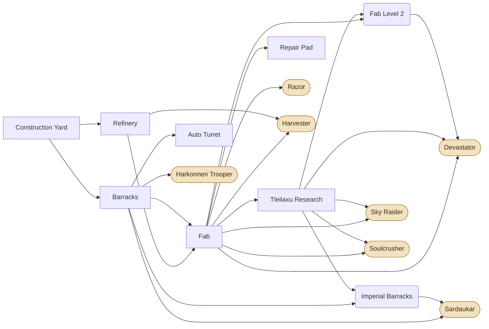
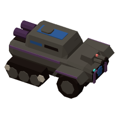
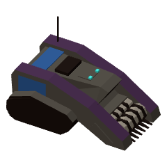
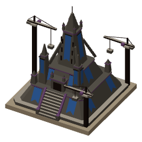
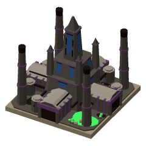
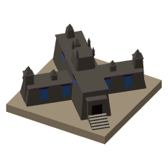
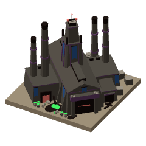
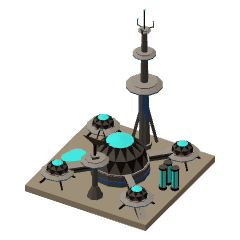
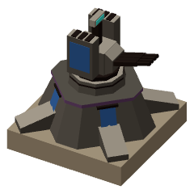
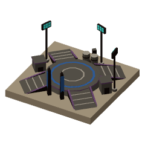

# Corrino

[Manual](README.md) · [Atreides](atreides.md) · **Corrino** · [Fremen](fremen.md)

## Overview

The Emperor's forces are slow, expensive and hard to kill. Every Corrino unit and structure carries a shield that takes damage before health and recharges once out of combat, so a Corrino army that wins a fight keeps most of its strength. What's lost in health only comes back at a Repair Pad.

**Strengths:** shields that recharge between fights, the heaviest units in the game (Devastator, Soulcrusher), Auto Turrets, structures that repair themselves, and drop pods that put infantry anywhere you can see.

**Weaknesses:** slow and costly, so every loss hurts; units only heal at a Repair Pad; Razors are the only fast unit, and they're no good against harvesters.

### How it plays

- **Start:** a Construction Yard, a Razor and two Harkonnen Troopers. Build a Refinery and a Barracks, then a Fab.
- **Economy:** Harvesters and Refineries, like Atreides, but Corrino Harvesters come from the Fab.
- **Army:** Troopers are the cheap core and the anti-vehicle infantry, Razors burn infantry, Devastators anchor the late army. Tleilaxu Research unlocks Sky Raiders, Soulcrushers and the level-ups that bring Devastators and Sardaukar.
- **Shields:** units and structures that don't list their own get shields of half their health. Shields start recovering 7 seconds after the last hit and refill in 10.
- **Healing:** units park next to a Repair Pad (two at a time) to get their health back, for credits. Damaged structures repair themselves when told to (Mend, on the structure's command card), paid like repairs, while a Construction Yard stands.
- **Drop pods:** with the Imperial Barracks, new infantry land by pod at the Barracks' rally point, anywhere your side can see. Set the rally point on a unit and they land next to it.
- **Upgrades:** one level each of Weapons, Armor and Shields, plus Flame Range for Razors and Harvesting.

<!-- specs -->
<!-- Generated from src/config by sim/manual.ts: edit the config, then rerun it. -->

## Tech tree

Structures (boxes), their level-ups (rounded) and the units they unlock (pills). Dotted arrows are Fremen rites.

## Units

<table>
<tr><td align="center" width="96"><a href="#harkonnen-trooper"> Harkonnen Trooper</a></td><td align="center" width="96"><a href="#sardaukar"> Sardaukar</a></td><td align="center" width="96"><a href="#razor"> Razor</a></td><td align="center" width="96"><a href="#devastator"> Devastator</a></td><td align="center" width="96"><a href="#harvester"> Harvester</a></td><td align="center" width="96"><a href="#sky-raider"> Sky Raider</a></td><td align="center" width="96"><a href="#soulcrusher"> Soulcrusher</a></td></tr>
</table>

Speed and sight in tiles. Damage is per hit before armor, plus the bonus against targets with that attribute; DPS is base damage over the cooldown. **Strong / weak against** list, from each faction, the unit this one beats (or loses to) most clearly in equal-cost fights in the open (siege units set up first, Infantry Rockets researched). For units that don't fight, weak against is what kills them fastest for its price.

### Harkonnen Trooper

<table><tr>
<td width="220" align="center" valign="top"></td>
<td valign="top">

<table>
<tr><th align="left">Cost</th><td>110</td></tr>
<tr><th align="left">Build time</th><td>6 s</td></tr>
<tr><th align="left">Made at</th><td>Barracks</td></tr>
<tr><th align="left">Requires</th><td>Barracks</td></tr>
<tr><th align="left">Health</th><td>80</td></tr>
<tr><th align="left">Shields</th><td>80</td></tr>
<tr><th align="left">Armor</th><td>0</td></tr>
<tr><th align="left">Attributes</th><td>Biological, Light</td></tr>
<tr><th align="left">Speed</th><td>1.25 tiles/s</td></tr>
<tr><th align="left">Sight</th><td>5 tiles</td></tr>
</table>

</td>
</tr></table>

Imperial levy raised from the beaten Harkonnen. Shoulder rockets: strong vs vehicles, beats trikes by numbers, and shoots at aircraft. Weak vs MLRS.

| Weapon | Damage | Cooldown (s) | DPS | Range (tiles) | Notes |
|---|---|---|---|---|---|
| Main | 10 (+10 vs armored) | 0.7 | 14.29 | 4.5 | hits aircraft for 10 |

**Strong against:**  [Tank](atreides.md#tank) &nbsp;  [Sky Raider](#sky-raider)

**Weak against:**  [Trike](atreides.md#trike) &nbsp;  [Soulcrusher](#soulcrusher) &nbsp;  [Fedaykin](fremen.md#fedaykin)

---

### Sardaukar

<table><tr>
<td width="220" align="center" valign="top"></td>
<td valign="top">

<table>
<tr><th align="left">Cost</th><td>260</td></tr>
<tr><th align="left">Build time</th><td>9 s</td></tr>
<tr><th align="left">Made at</th><td>Barracks</td></tr>
<tr><th align="left">Requires</th><td>Imperial Barracks</td></tr>
<tr><th align="left">Health</th><td>180</td></tr>
<tr><th align="left">Shields</th><td>100</td></tr>
<tr><th align="left">Armor</th><td>1</td></tr>
<tr><th align="left">Attributes</th><td>Biological, Light</td></tr>
<tr><th align="left">Speed</th><td>1.57 tiles/s</td></tr>
<tr><th align="left">Sight</th><td>5 tiles</td></tr>
</table>

</td>
</tr></table>

The Emperor's elite. Close-quarters fighters: tear through infantry and shoot down aircraft. Weak vs trikes and MLRS.

| Weapon | Damage | Cooldown (s) | DPS | Range (tiles) | Notes |
|---|---|---|---|---|---|
| Main | 18 (+18 vs biological) | 0.75 | 24 | 2.75 | hits aircraft for 24 |

**Strong against:**  [Tank](atreides.md#tank) &nbsp;  [Sky Raider](#sky-raider) &nbsp;  [Fremen Warrior](fremen.md#fremen-warrior)

**Weak against:**  [Trike](atreides.md#trike) &nbsp;  [Devastator](#devastator) &nbsp;  [Fedaykin](fremen.md#fedaykin)

---

### Razor

<table><tr>
<td width="220" align="center" valign="top"></td>
<td valign="top">

<table>
<tr><th align="left">Cost</th><td>250</td></tr>
<tr><th align="left">Build time</th><td>7 s</td></tr>
<tr><th align="left">Made at</th><td>Fab</td></tr>
<tr><th align="left">Requires</th><td>Fab</td></tr>
<tr><th align="left">Health</th><td>135</td></tr>
<tr><th align="left">Shields</th><td>80</td></tr>
<tr><th align="left">Armor</th><td>1</td></tr>
<tr><th align="left">Attributes</th><td>Mechanical, Light</td></tr>
<tr><th align="left">Speed</th><td>3 tiles/s</td></tr>
<tr><th align="left">Sight</th><td>5.5 tiles</td></tr>
</table>

</td>
</tr></table>

Dune buggy with a flamethrower that burns everything in front of it. Shreds infantry. Weak vs tanks.

| Weapon | Damage | Cooldown (s) | DPS | Range (tiles) | Notes |
|---|---|---|---|---|---|
| Main | 10 (+12 vs biological) | 0.6 | 16.67 | 2 | ground only; cone ±20° |

**Strong against:**  [Infantry](atreides.md#infantry) &nbsp;  [Sardaukar](#sardaukar) &nbsp;  [Fremen Warrior](fremen.md#fremen-warrior)

**Weak against:**  [Trike](atreides.md#trike) &nbsp;  [Sky Raider](#sky-raider) &nbsp;  [Fedaykin](fremen.md#fedaykin)

---

### Devastator

<table><tr>
<td width="220" align="center" valign="top"></td>
<td valign="top">

<table>
<tr><th align="left">Cost</th><td>800</td></tr>
<tr><th align="left">Build time</th><td>16 s</td></tr>
<tr><th align="left">Made at</th><td>Fab</td></tr>
<tr><th align="left">Requires</th><td>Tleilaxu Research, Fab Level 2</td></tr>
<tr><th align="left">Health</th><td>720</td></tr>
<tr><th align="left">Shields</th><td>320</td></tr>
<tr><th align="left">Armor</th><td>3</td></tr>
<tr><th align="left">Attributes</th><td>Mechanical, Armored</td></tr>
<tr><th align="left">Speed</th><td>1.2 tiles/s</td></tr>
<tr><th align="left">Sight</th><td>6 tiles</td></tr>
</table>

</td>
</tr></table>

Slow heavy tank. Its heavy gun hits anything on the ground and crushes armor, but only fires standing still; its machine gun cuts down infantry, even on the move. Can self-destruct in a huge blast. Weak vs aircraft, MLRS and massed troopers.

- The main gun only fires standing still; the machine gun fires on the move.
- **Self-destruct** (V): blows up 2.5 s after the order.

| Weapon | Damage | Cooldown (s) | DPS | Range (tiles) | Notes |
|---|---|---|---|---|---|
| Main gun | 60 (+40 vs armored) | 2 | 30 | 5 | ground only; splash 0.75 tiles |
| Machine gun | 8 (+4 vs biological) | 0.2 | 40 | 4.5 | ground only |
| Self-destruct | 500 (+300 vs structure) | – | – | – | ground only; splash 4.5 tiles; Weapons upgrades don't change it |

**Strong against:**  [MLRS](atreides.md#mlrs) &nbsp;  [Sardaukar](#sardaukar) &nbsp;  [Fremen Warrior](fremen.md#fremen-warrior)

**Weak against:**  [Infantry](atreides.md#infantry) &nbsp;  [Sky Raider](#sky-raider)

---

### Harvester

<table><tr>
<td width="220" align="center" valign="top"></td>
<td valign="top">

<table>
<tr><th align="left">Cost</th><td>800</td></tr>
<tr><th align="left">Build time</th><td>10 s</td></tr>
<tr><th align="left">Made at</th><td>Fab</td></tr>
<tr><th align="left">Requires</th><td>Fab, Refinery</td></tr>
<tr><th align="left">Health</th><td>600</td></tr>
<tr><th align="left">Shields</th><td>300</td></tr>
<tr><th align="left">Armor</th><td>2</td></tr>
<tr><th align="left">Attributes</th><td>Mechanical, Light</td></tr>
<tr><th align="left">Speed</th><td>1.5 tiles/s</td></tr>
<tr><th align="left">Sight</th><td>4 tiles</td></tr>
</table>

</td>
</tr></table>

Collects spice and brings it to a Refinery.

**Strong against:** –

**Weak against:**  [Trike](atreides.md#trike) &nbsp;  [Harkonnen Trooper](#harkonnen-trooper) &nbsp;  [Fremen Warrior](fremen.md#fremen-warrior)

---

### Sky Raider

<table><tr>
<td width="220" align="center" valign="top"></td>
<td valign="top">

<table>
<tr><th align="left">Cost</th><td>600</td></tr>
<tr><th align="left">Build time</th><td>13 s</td></tr>
<tr><th align="left">Made at</th><td>Fab</td></tr>
<tr><th align="left">Requires</th><td>Tleilaxu Research</td></tr>
<tr><th align="left">Health</th><td>200</td></tr>
<tr><th align="left">Shields</th><td>100</td></tr>
<tr><th align="left">Armor</th><td>1</td></tr>
<tr><th align="left">Attributes</th><td>Mechanical, Air</td></tr>
<tr><th align="left">Speed</th><td>4.5 tiles/s</td></tr>
<tr><th align="left">Sight</th><td>7 tiles</td></tr>
</table>

</td>
</tr></table>

Light ornithopter for scouting and raids. Rockets strong vs armor. Lays mines that wreck infantry and wear down harvesters. Weak vs anti-air.

- **Lay Mine** (D): one every 15 s, at most 12 per side; an enemy on the ground within 1.1 tiles sets it off.
- **Flies:** crosses any terrain; only anti-air weapons can hit it.

| Weapon | Damage | Cooldown (s) | DPS | Range (tiles) | Notes |
|---|---|---|---|---|---|
| Main | 16 (+20 vs armored) | 1.2 | 13.33 | 2.5 | ground only |
| Mine | 40 (+60 vs biological) | – | – | – | ground only; splash 2 tiles |

**Strong against:**  [Tank](atreides.md#tank) &nbsp;  [Soulcrusher](#soulcrusher) &nbsp;  [Fremen Mortar](fremen.md#fremen-mortar)

**Weak against:**  [Infantry](atreides.md#infantry) &nbsp;  [Harkonnen Trooper](#harkonnen-trooper) &nbsp;  [Fedaykin](fremen.md#fedaykin)

---

### Soulcrusher

<table><tr>
<td width="220" align="center" valign="top"></td>
<td valign="top">

<table>
<tr><th align="left">Cost</th><td>650</td></tr>
<tr><th align="left">Build time</th><td>13 s</td></tr>
<tr><th align="left">Made at</th><td>Fab</td></tr>
<tr><th align="left">Requires</th><td>Tleilaxu Research</td></tr>
<tr><th align="left">Health</th><td>200</td></tr>
<tr><th align="left">Shields</th><td>110</td></tr>
<tr><th align="left">Armor</th><td>2</td></tr>
<tr><th align="left">Attributes</th><td>Mechanical, Armored</td></tr>
<tr><th align="left">Speed</th><td>1.4 tiles/s</td></tr>
<tr><th align="left">Sight</th><td>6 tiles</td></tr>
</table>

</td>
</tr></table>

Self-propelled howitzer with a short gun, and can't fire on the move. Deployed, it shells anything your side can see at long range; the shells are slow and fall where the target was. Brutal on buildings and defenses. Weak vs tanks.

- **Set up** (D): 3 s, and as long to pack up. Set up, it can't move and fires its long-range weapon.
- Can't fire on the move.

| Weapon | Damage | Cooldown (s) | DPS | Range (tiles) | Notes |
|---|---|---|---|---|---|
| Mobile | 14 (+12 vs structure) | 1.5 | 9.33 | 4 | ground only |
| Set up | 70 (+110 vs structure) | 4.5 | 15.56 | 4–13 | ground only; splash 2 tiles; unguided: falls where the target stood |

**Strong against:**  [Infantry](atreides.md#infantry) &nbsp;  [Razor](#razor) &nbsp;  [Fremen Warrior](fremen.md#fremen-warrior)

**Weak against:**  [Tank](atreides.md#tank) &nbsp;  [Sky Raider](#sky-raider)

## Structures

<table>
<tr><td align="center" width="96"><a href="#construction-yard"> Construction Yard</a></td><td align="center" width="96"><a href="#refinery"> Refinery</a></td><td align="center" width="96"><a href="#barracks"> Barracks</a></td><td align="center" width="96"><a href="#fab"> Fab</a></td><td align="center" width="96"><a href="#tleilaxu-research"> Tleilaxu Research</a></td><td align="center" width="96"><a href="#auto-turret"> Auto Turret</a></td><td align="center" width="96"><a href="#repair-pad"> Repair Pad</a></td></tr>
</table>

### Construction Yard

<table><tr>
<td width="220" align="center" valign="top"></td>
<td valign="top">

<table>
<tr><th align="left">Cost</th><td>2500</td></tr>
<tr><th align="left">Build time</th><td>25 s</td></tr>
<tr><th align="left">Requires</th><td>–</td></tr>
<tr><th align="left">Health</th><td>1600</td></tr>
<tr><th align="left">Shields</th><td>800</td></tr>
<tr><th align="left">Armor</th><td>5</td></tr>
<tr><th align="left">Size</th><td>3×3 tiles</td></tr>
</table>

</td>
</tr></table>

Builds structures, one at a time. Lose all of these and you cannot build.

---

### Refinery

<table><tr>
<td width="220" align="center" valign="top"></td>
<td valign="top">

<table>
<tr><th align="left">Cost</th><td>1200</td></tr>
<tr><th align="left">Build time</th><td>14 s</td></tr>
<tr><th align="left">Requires</th><td>–</td></tr>
<tr><th align="left">Health</th><td>1000</td></tr>
<tr><th align="left">Shields</th><td>500</td></tr>
<tr><th align="left">Armor</th><td>5</td></tr>
<tr><th align="left">Size</th><td>3×3 tiles</td></tr>
</table>

</td>
</tr></table>

Processes spice into credits. Comes with a free Harvester.

---

### Barracks

<table><tr>
<td width="220" align="center" valign="top"></td>
<td valign="top">

<table>
<tr><th align="left">Cost</th><td>400</td></tr>
<tr><th align="left">Build time</th><td>10 s</td></tr>
<tr><th align="left">Requires</th><td>–</td></tr>
<tr><th align="left">Health</th><td>800</td></tr>
<tr><th align="left">Shields</th><td>400</td></tr>
<tr><th align="left">Armor</th><td>5</td></tr>
<tr><th align="left">Size</th><td>2×2 tiles</td></tr>
</table>

</td>
</tr></table>

Trains infantry. Each Barracks adds a production line.

- **Imperial Barracks** (level-up): 800 credits, 40 s, needs Tleilaxu Research. Upgrades a Barracks. Unlocks Sardaukar and drop pods: new infantry land by pod at the rally point, anywhere you can see.

---

### Fab

<table><tr>
<td width="220" align="center" valign="top"></td>
<td valign="top">

<table>
<tr><th align="left">Cost</th><td>1100</td></tr>
<tr><th align="left">Build time</th><td>15 s</td></tr>
<tr><th align="left">Requires</th><td>Refinery, Barracks</td></tr>
<tr><th align="left">Health</th><td>1200</td></tr>
<tr><th align="left">Shields</th><td>600</td></tr>
<tr><th align="left">Armor</th><td>5</td></tr>
<tr><th align="left">Size</th><td>3×3 tiles</td></tr>
</table>

</td>
</tr></table>

Builds vehicles and aircraft. Each Fab adds a production line.

- **Fab Level 2** (level-up): 1000 credits, 40 s, needs Tleilaxu Research. Upgrades a Fab. Unlocks Devastators.

---

### Tleilaxu Research

<table><tr>
<td width="220" align="center" valign="top"></td>
<td valign="top">

<table>
<tr><th align="left">Cost</th><td>1300</td></tr>
<tr><th align="left">Build time</th><td>18 s</td></tr>
<tr><th align="left">Requires</th><td>Fab</td></tr>
<tr><th align="left">Health</th><td>1000</td></tr>
<tr><th align="left">Shields</th><td>500</td></tr>
<tr><th align="left">Armor</th><td>5</td></tr>
<tr><th align="left">Size</th><td>3×3 tiles</td></tr>
</table>

</td>
</tr></table>

Tleilaxu biotech. Unlocks Sky Raiders, Soulcrushers, Devastators and Shields.

---

### Auto Turret

<table><tr>
<td width="220" align="center" valign="top"></td>
<td valign="top">

<table>
<tr><th align="left">Cost</th><td>350</td></tr>
<tr><th align="left">Build time</th><td>9 s</td></tr>
<tr><th align="left">Requires</th><td>Barracks</td></tr>
<tr><th align="left">Health</th><td>700</td></tr>
<tr><th align="left">Shields</th><td>350</td></tr>
<tr><th align="left">Armor</th><td>5</td></tr>
<tr><th align="left">Size</th><td>1×1 tiles</td></tr>
</table>

</td>
</tr></table>

Small automatic gun emplacement. Shoots ground targets in range.

- **Gun:** 14 (+6 vs mechanical) every 0.9 s, range 6 tiles, ground only.

---

### Repair Pad

<table><tr>
<td width="220" align="center" valign="top"></td>
<td valign="top">

<table>
<tr><th align="left">Cost</th><td>700</td></tr>
<tr><th align="left">Build time</th><td>12 s</td></tr>
<tr><th align="left">Requires</th><td>Fab</td></tr>
<tr><th align="left">Health</th><td>900</td></tr>
<tr><th align="left">Shields</th><td>450</td></tr>
<tr><th align="left">Armor</th><td>5</td></tr>
<tr><th align="left">Size</th><td>2×2 tiles</td></tr>
</table>

</td>
</tr></table>

Restores the health of units parked next to it, two at a time, for credits. Right-click it with units selected. Corrino units don't heal anywhere else.

- **Repairs** 2 units at a time, 25 HP/s each.

## Research

Researched one at a time, from the Upgrade tab. Weapons levels add 15% of each hit (bonus included); Armor levels take one more point off every hit.

| Upgrade | Cost | Time | Requires | Effect |
|---|---|---|---|---|
| Weapons +1 | 1100 | 40 s | Fab | Every weapon hits 15% harder, bonus damage included (armor still comes off each hit). |
| Armor +1 | 700 | 25 s | Fab | +1 armor for all units and buildings: one less damage from every hit (from shields too). |
| Shields +1 | 400 | 20 s | Tleilaxu Research | Shields take one less damage from every hit. |
| Razor Flame Range | 500 | 20 s | Fab | Razor flamethrowers reach one tile further. |
| Harvesting | 600 | 20 s | Refinery, Fab | Harvesters carry 25% more, move 25% faster and pick up spice 50% faster. |

<!-- /specs -->
