# Fremen

[Manual](README.md) · [Atreides](atreides.md) · [Corrino](corrino.md) · **Fremen**

## Overview

The Fremen are the desert itself: cheap, fast infantry that dig into the sand and vanish, heal on their own, and call Sandworms down on the enemy. They have no vehicles and no harvesters. Their warriors grow into elite units through rites, in the field.

**Strengths:** cheap units, hiding and ambushes, speed on sand, healing without repairs, Sandworms, and an economy that sets up wherever the spice is.

**Weaknesses:** infantry only, so splash damage and flamethrowers hurt; nothing is very tough; slow against structures until Mortars and worms arrive.

### How it plays

- **Start:** a Sietch, three Warriors and a Spice Crew. Walk the Crew onto a spice field and Set Up Camp (D), then build a Barracks for more crews and Warriors.
- **Economy:** Spice Camps turn the spice around them into credits, fastest with plenty of spice in reach. Move them on (Pack Up, D) when the field runs low. More Crews mean more income.
- **Rites:** Warriors become Fedaykin or Fremen Mortars, and Fedaykin become Sandriders, right where they stand: select them, pick the rite on the Command tab, and they dig in for a few seconds. It costs credits and can't be undone. The rites unlock with the Sietch's levels (Great Sietch, then Sietch III).
- **Hiding:** a Fremen unit standing still on sand for 3 seconds digs in, out of the enemy's sight unless they come right up to it. Dig In (V) does it at once and holds fire. With Ambush, units striking out of hiding deal 75% more damage for 4 seconds.
- **Healing:** Fremen units heal 1.5% of their health per second after 6 seconds unhurt, twice as fast dug in or near a High Perch. Stillsuits double it again and start it sooner. Structures heal slowly on their own too.
- **Speed:** Fremen infantry move 20% faster on sand and spice, and Sandwalk adds 25% on top.
- **Sandworms:** a Sandrider plants a Thumper (250 credits; then 60 seconds before that rider can plant another). If the Sandrider is close when the worm comes, they ride it. Send the worm into the enemy, and Release Worm lets it go. See [Sandworms](README.md#sandworms).
- **Air:** the High Perch launches Wind Gliders, fast unarmed scouts that never stop moving.
- **Upgrades:** two levels each of Weapons and Armor (one per Sietch level), plus Stillsuits, Sandwalk, Ambush and Spice Mining. They're cheap: the Sietch levels carry the cost.

<!-- specs -->
<!-- Generated from src/config by sim/manual.ts: edit the config, then rerun it. -->

## Tech tree

Structures (boxes), their level-ups (rounded) and the units they unlock (pills). Dotted arrows are Fremen rites.

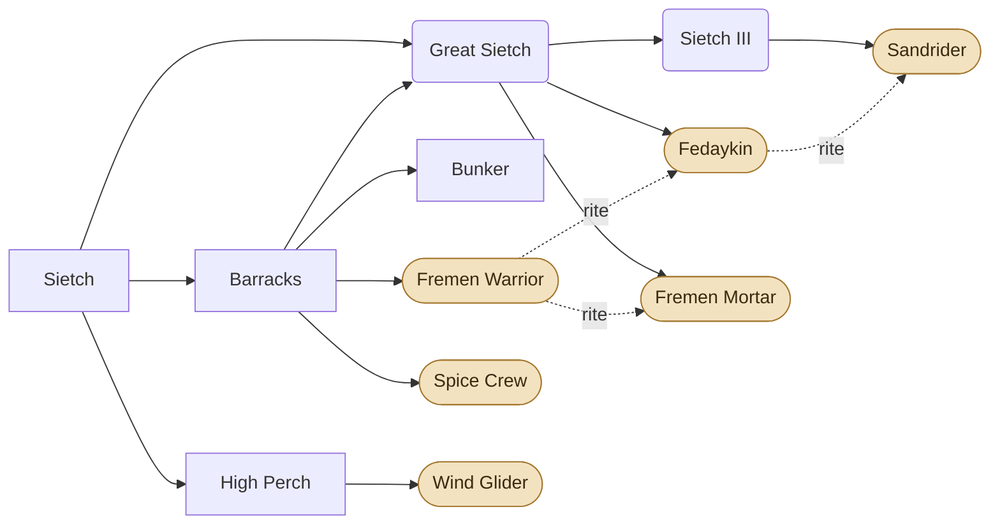

## Units

<table>
<tr><td align="center" width="96"><a href="#fremen-warrior">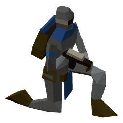 Fremen Warrior</a></td><td align="center" width="96"><a href="#spice-crew">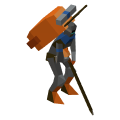 Spice Crew</a></td><td align="center" width="96"><a href="#wind-glider">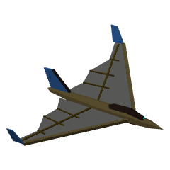 Wind Glider</a></td><td align="center" width="96"><a href="#fedaykin">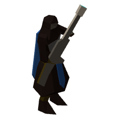 Fedaykin</a></td><td align="center" width="96"><a href="#fremen-mortar">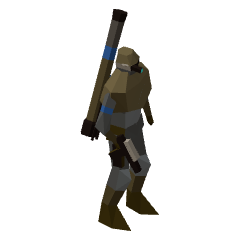 Fremen Mortar</a></td><td align="center" width="96"><a href="#sandrider">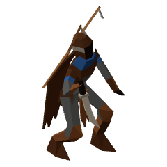 Sandrider</a></td></tr>
</table>

Speed and sight in tiles. Damage is per hit before armor, plus the bonus against targets with that attribute; DPS is base damage over the cooldown. **Strong / weak against** list, from each faction, the unit this one beats (or loses to) most clearly in equal-cost fights in the open (siege units set up first, Infantry Rockets researched). For units that don't fight, weak against is what kills them fastest for its price.

### Fremen Warrior

<table><tr>
<td width="220" align="center" valign="top"></td>
<td valign="top">

<table>
<tr><th align="left">Cost</th><td>80</td></tr>
<tr><th align="left">Build time</th><td>3.5 s</td></tr>
<tr><th align="left">Made at</th><td>Barracks</td></tr>
<tr><th align="left">Requires</th><td>Barracks</td></tr>
<tr><th align="left">Health</th><td>70</td></tr>
<tr><th align="left">Armor</th><td>0</td></tr>
<tr><th align="left">Attributes</th><td>Biological, Light</td></tr>
<tr><th align="left">Speed</th><td>1.57 tiles/s</td></tr>
<tr><th align="left">Sight</th><td>5.5 tiles</td></tr>
</table>

</td>
</tr></table>

Cheap, fast desert fighter with a maula pistol and a crysknife. Strong vs infantry, can shoot at aircraft. Weak vs vehicles, flamers and structures. Goes through rites to become a Fedaykin or a Fremen Mortar.

- **Hides:** digs into the sand standing still on it; **Dig In** (V) at once. See [Hiding](README.md#hiding-fremen).

| Weapon | Damage | Cooldown (s) | DPS | Range (tiles) | Notes |
|---|---|---|---|---|---|
| Main | 7 (+3 vs biological) | 0.55 | 12.73 | 2.25 | hits aircraft |

**Strong against:** 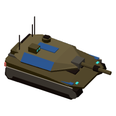 [Tank](atreides.md#tank) &nbsp; 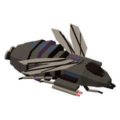 [Sky Raider](corrino.md#sky-raider)

**Weak against:** 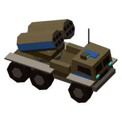 [MLRS](atreides.md#mlrs) &nbsp; 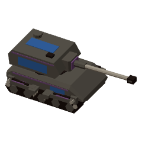 [Soulcrusher](corrino.md#soulcrusher) &nbsp;  [Fremen Mortar](#fremen-mortar)

---

### Spice Crew

<table><tr>
<td width="220" align="center" valign="top"></td>
<td valign="top">

<table>
<tr><th align="left">Cost</th><td>450</td></tr>
<tr><th align="left">Build time</th><td>12 s</td></tr>
<tr><th align="left">Made at</th><td>Barracks</td></tr>
<tr><th align="left">Requires</th><td>Barracks</td></tr>
<tr><th align="left">Health</th><td>120</td></tr>
<tr><th align="left">Armor</th><td>0</td></tr>
<tr><th align="left">Attributes</th><td>Biological, Light</td></tr>
<tr><th align="left">Speed</th><td>1.57 tiles/s</td></tr>
<tr><th align="left">Sight</th><td>4.5 tiles</td></tr>
</table>

</td>
</tr></table>

Unarmed spice hunters. Walk them onto a spice field and Set Up Camp (D): the Spice Camp turns the spice around it into credits. Pack it up again when the spice runs out.

- **Set Up Camp** (D): becomes a Spice Camp on a spice field, and packs up again.
- **Hides:** digs into the sand standing still on it; **Dig In** (V) at once. See [Hiding](README.md#hiding-fremen).

**Strong against:** –

**Weak against:** 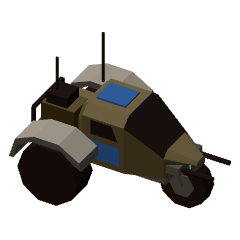 [Trike](atreides.md#trike) &nbsp; 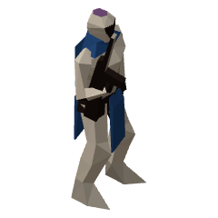 [Sardaukar](corrino.md#sardaukar) &nbsp;  [Sandrider](#sandrider)

---

### Wind Glider

<table><tr>
<td width="220" align="center" valign="top"></td>
<td valign="top">

<table>
<tr><th align="left">Cost</th><td>100</td></tr>
<tr><th align="left">Build time</th><td>6 s</td></tr>
<tr><th align="left">Made at</th><td>High Perch</td></tr>
<tr><th align="left">Requires</th><td>High Perch</td></tr>
<tr><th align="left">Health</th><td>60</td></tr>
<tr><th align="left">Armor</th><td>0</td></tr>
<tr><th align="left">Attributes</th><td>Light, Air</td></tr>
<tr><th align="left">Speed</th><td>5 tiles/s</td></tr>
<tr><th align="left">Sight</th><td>8 tiles</td></tr>
</table>

</td>
</tr></table>

A Fremen rider on a cloth wing, riding the desert winds. The fastest thing in the sky and sees far, but unarmed and frail. It can't hover: with nowhere to go, it circles.

- **Flies:** crosses any terrain; only anti-air weapons can hit it.

**Strong against:** –

**Weak against:** 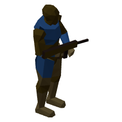 [Infantry](atreides.md#infantry) &nbsp; 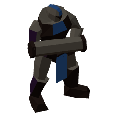 [Harkonnen Trooper](corrino.md#harkonnen-trooper) &nbsp;  [Fremen Warrior](#fremen-warrior)

---

### Fedaykin

<table><tr>
<td width="220" align="center" valign="top"></td>
<td valign="top">

<table>
<tr><th align="left">Cost</th><td>115 (rite, from a Fremen Warrior)</td></tr>
<tr><th align="left">Rite time</th><td>6.5 s</td></tr>
<tr><th align="left">Requires</th><td>Great Sietch</td></tr>
<tr><th align="left">Health</th><td>230</td></tr>
<tr><th align="left">Armor</th><td>1</td></tr>
<tr><th align="left">Attributes</th><td>Biological, Light</td></tr>
<tr><th align="left">Speed</th><td>1.57 tiles/s</td></tr>
<tr><th align="left">Sight</th><td>5.5 tiles</td></tr>
</table>

</td>
</tr></table>

Elite fighters with weirding modules: sonic blasts that hit everything in a narrow cone, crack armor and pass straight through shields. Strong vs tanks and massed infantry, fair vs light vehicles, can shoot at aircraft. Weak vs Sandriders and slow against structures. With Sietch III, can go through the rite of the Sandrider.

- **Rite:** a Fremen Warrior becomes one in 6.5 s for 115 credits (one way).
- **Hides:** digs into the sand standing still on it; **Dig In** (V) at once. See [Hiding](README.md#hiding-fremen).

| Weapon | Damage | Cooldown (s) | DPS | Range (tiles) | Notes |
|---|---|---|---|---|---|
| Main | 14 (+12 vs armored) | 1 | 14 | 3.5 | hits aircraft; cone ±14°; ignores shields |

**Strong against:**  [Infantry](atreides.md#infantry) &nbsp;  [Sky Raider](corrino.md#sky-raider) &nbsp;  [Fremen Warrior](#fremen-warrior)

**Weak against:**  [MLRS](atreides.md#mlrs) &nbsp;  [Soulcrusher](corrino.md#soulcrusher) &nbsp;  [Fremen Mortar](#fremen-mortar)

---

### Fremen Mortar

<table><tr>
<td width="220" align="center" valign="top"></td>
<td valign="top">

<table>
<tr><th align="left">Cost</th><td>160 (rite, from a Fremen Warrior)</td></tr>
<tr><th align="left">Rite time</th><td>8.5 s</td></tr>
<tr><th align="left">Requires</th><td>Great Sietch</td></tr>
<tr><th align="left">Health</th><td>120</td></tr>
<tr><th align="left">Armor</th><td>0</td></tr>
<tr><th align="left">Attributes</th><td>Biological, Light</td></tr>
<tr><th align="left">Speed</th><td>1.57 tiles/s</td></tr>
<tr><th align="left">Sight</th><td>6 tiles</td></tr>
</table>

</td>
</tr></table>

A Fremen with a heavy rocket mortar on his back and a pistol in his belt. On the move he barely fights; set up (D, 1.5 s), he lobs guided rockets at anything your side can see out to 6 tiles: strong vs vehicles, structures and packed infantry. Can't fire up close, and in the sand he digs in like any Fremen.

- **Rite:** a Fremen Warrior becomes one in 8.5 s for 160 credits (one way).
- **Set up** (D): 1.5 s, and as long to pack up. Set up, it can't move and fires its long-range weapon.
- **Hides:** digs into the sand standing still on it; **Dig In** (V) at once. See [Hiding](README.md#hiding-fremen).

| Weapon | Damage | Cooldown (s) | DPS | Range (tiles) | Notes |
|---|---|---|---|---|---|
| Mobile | 6 | 0.8 | 7.5 | 2.25 | ground only |
| Set up | 28 (+26 vs structure) | 1.4 | 20 | 2–6 | ground only; splash 1.5 tiles |

**Strong against:**  [Infantry](atreides.md#infantry) &nbsp;  [Harkonnen Trooper](corrino.md#harkonnen-trooper) &nbsp;  [Fremen Warrior](#fremen-warrior)

**Weak against:**  [Trike](atreides.md#trike) &nbsp;  [Sky Raider](corrino.md#sky-raider)

---

### Sandrider

<table><tr>
<td width="220" align="center" valign="top"></td>
<td valign="top">

<table>
<tr><th align="left">Cost</th><td>220 (rite, from a Fedaykin)</td></tr>
<tr><th align="left">Rite time</th><td>10 s</td></tr>
<tr><th align="left">Requires</th><td>Sietch III</td></tr>
<tr><th align="left">Health</th><td>280</td></tr>
<tr><th align="left">Armor</th><td>1</td></tr>
<tr><th align="left">Attributes</th><td>Biological, Light</td></tr>
<tr><th align="left">Speed</th><td>1.57 tiles/s</td></tr>
<tr><th align="left">Sight</th><td>5.5 tiles</td></tr>
</table>

</td>
</tr></table>

A Fremen who has ridden Shai-Hulud. Plants a Thumper and rides the worm it calls until you let it go: the worm goes where you send it and swallows the enemy on the sand (vehicles most of all), never your own. On foot, a zealot: rushes the most valuable enemy infantry about and kills it with one stroke of the crysknife, a slow blade that passes any shield. Can't hurt vehicles, structures or aircraft on foot.

- **Rite:** a Fedaykin becomes one in 10 s for 220 credits (one way).
- **Charge:** closing on a target within 3 tiles, it runs 2× as fast.
- **Plant Thumper** (D) and ride the Sandworm that comes; **Release Worm** lets it go. See [Sandworms](README.md#sandworms).
- **Hides:** digs into the sand standing still on it; **Dig In** (V) at once. See [Hiding](README.md#hiding-fremen).

| Weapon | Damage | Cooldown (s) | DPS | Range (tiles) | Notes |
|---|---|---|---|---|---|
| Main | 400 | 1.6 | 250 | 0.45 | ground only; ignores shields; only hits biological targets; Weapons upgrades don't change it |

**Strong against:**  [Tank](atreides.md#tank) (its worm) &nbsp; 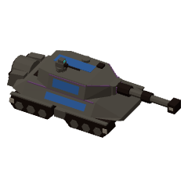 [Devastator](corrino.md#devastator) (its worm)

**Weak against:**  [Trike](atreides.md#trike) &nbsp;  [Sky Raider](corrino.md#sky-raider) &nbsp;  [Fremen Warrior](#fremen-warrior)

## Structures

<table>
<tr><td align="center" width="96"><a href="#sietch">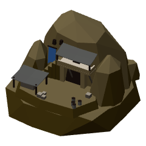 Sietch</a></td><td align="center" width="96"><a href="#barracks">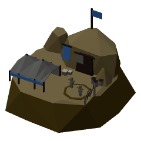 Barracks</a></td><td align="center" width="96"><a href="#high-perch">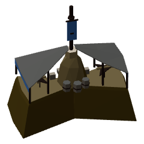 High Perch</a></td><td align="center" width="96"><a href="#bunker">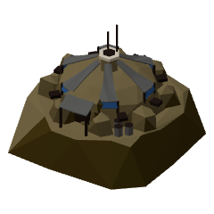 Bunker</a></td><td align="center" width="96"><a href="#spice-camp">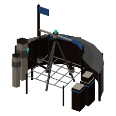 Spice Camp</a></td><td align="center" width="96"><a href="#thumper">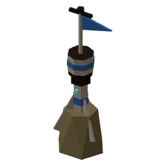 Thumper</a></td></tr>
</table>

### Sietch

<table><tr>
<td width="220" align="center" valign="top"></td>
<td valign="top">

<table>
<tr><th align="left">Cost</th><td>2000</td></tr>
<tr><th align="left">Build time</th><td>25 s</td></tr>
<tr><th align="left">Requires</th><td>–</td></tr>
<tr><th align="left">Health</th><td>1600</td></tr>
<tr><th align="left">Armor</th><td>5</td></tr>
<tr><th align="left">Size</th><td>3×3 tiles</td></tr>
</table>

</td>
</tr></table>

A Fremen stronghold, and their hub: builds structures, one at a time. Lose all of these and you cannot build.

- **Great Sietch** (level-up): 1000 credits, 35 s, needs Barracks. Upgrades a Sietch. Unlocks Fedaykin, Fremen Mortars, Thumpers, Weapons +1, Armor +1 and Stillsuits.
- **Sietch III** (level-up): 1500 credits, 45 s, needs Great Sietch. Upgrades a Great Sietch. Unlocks the Sandrider, Weapons +2, Armor +2 and Ambush.

---

### Barracks

<table><tr>
<td width="220" align="center" valign="top"></td>
<td valign="top">

<table>
<tr><th align="left">Cost</th><td>400</td></tr>
<tr><th align="left">Build time</th><td>10 s</td></tr>
<tr><th align="left">Requires</th><td>–</td></tr>
<tr><th align="left">Health</th><td>800</td></tr>
<tr><th align="left">Armor</th><td>5</td></tr>
<tr><th align="left">Size</th><td>2×2 tiles</td></tr>
</table>

</td>
</tr></table>

Trains infantry. Each Barracks adds a production line.

---

### High Perch

<table><tr>
<td width="220" align="center" valign="top"></td>
<td valign="top">

<table>
<tr><th align="left">Cost</th><td>600</td></tr>
<tr><th align="left">Build time</th><td>12 s</td></tr>
<tr><th align="left">Requires</th><td>–</td></tr>
<tr><th align="left">Health</th><td>700</td></tr>
<tr><th align="left">Armor</th><td>5</td></tr>
<tr><th align="left">Size</th><td>2×2 tiles</td></tr>
</table>

</td>
</tr></table>

A glider roost on a rock spur: Fremen engineers build and launch Wind Gliders here (each High Perch adds a production line). Its cisterns water the troops: Fremen units and structures near it heal twice as fast.

- **Heals** Fremen units and structures 2× as fast within 5 tiles.

---

### Bunker

<table><tr>
<td width="220" align="center" valign="top"></td>
<td valign="top">

<table>
<tr><th align="left">Cost</th><td>400</td></tr>
<tr><th align="left">Build time</th><td>10 s</td></tr>
<tr><th align="left">Requires</th><td>Barracks</td></tr>
<tr><th align="left">Health</th><td>1400</td></tr>
<tr><th align="left">Armor</th><td>5</td></tr>
<tr><th align="left">Size</th><td>2×2 tiles</td></tr>
</table>

</td>
</tr></table>

Holds three infantry, who shoot from it and can't be hurt while inside. Right-click it with infantry selected; Unload on the command card lets them out.

- **Garrison:** 3 infantry.

---

### Spice Camp

<table><tr>
<td width="220" align="center" valign="top"></td>
<td valign="top">

<table>
<tr><th align="left">Cost</th><td>– (a Spice Crew sets it up)</td></tr>
<tr><th align="left">Build time</th><td>set up by a unit</td></tr>
<tr><th align="left">Requires</th><td>–</td></tr>
<tr><th align="left">Health</th><td>500</td></tr>
<tr><th align="left">Armor</th><td>5</td></tr>
<tr><th align="left">Size</th><td>2×2 tiles</td></tr>
</table>

</td>
</tr></table>

Set up by a Spice Crew on a spice field: turns the spice around it into credits. Packs up into a crew again (D) when the field runs dry.

- **Income:** up to 7.2 credits/s from the spice within 3.5 tiles.

---

### Thumper

<table><tr>
<td width="220" align="center" valign="top"></td>
<td valign="top">

<table>
<tr><th align="left">Cost</th><td>250</td></tr>
<tr><th align="left">Build time</th><td>set up by a unit</td></tr>
<tr><th align="left">Requires</th><td>Great Sietch</td></tr>
<tr><th align="left">Health</th><td>150</td></tr>
<tr><th align="left">Armor</th><td>5</td></tr>
<tr><th align="left">Size</th><td>1×1 tiles</td></tr>
</table>

</td>
</tr></table>

Planted in the sand by a Sandrider, it drums until a Sandworm comes: the Sandrider climbs on if it is close by; otherwise the worm comes wild and swallows anything on the sand around it, whoever it belongs to. Destroy it before then and no worm comes.

- Goes on open sand or spice only.

## Research

Researched one at a time, from the Upgrade tab. Weapons levels add 15% of each hit (bonus included); Armor levels take one more point off every hit.

| Upgrade | Cost | Time | Requires | Effect |
|---|---|---|---|---|
| Weapons +1 | 350 | 20 s | Great Sietch | Every weapon hits 15% harder, bonus damage included (armor still comes off each hit). |
| Weapons +2 | 550 | 30 s | Weapons +1, Sietch III | Every weapon hits 30% harder in all, bonus damage included. |
| Armor +1 | 350 | 20 s | Great Sietch | +1 armor for all units and buildings: one less damage from every hit. |
| Armor +2 | 550 | 30 s | Armor +1, Sietch III | +2 armor in all for units and buildings. |
| Ambush | 400 | 30 s | Sietch III | Units striking out of hiding deal +75% damage for 4 s. |
| Stillsuits | 400 | 20 s | Great Sietch | Fremen units heal twice as fast, and start sooner after being hurt. |
| Sandwalk | 500 | 20 s | – | Fremen infantry move a further 25% faster on sand and spice. |
| Spice Mining | 600 | 20 s | – | Spice Camps turn spice into credits 25% faster. |

<!-- /specs -->
